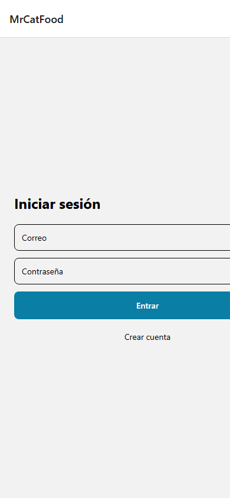

# Manual de administradora — MrCatFood

La cuenta administrativa se crea desde la configuración segura del backend. No se puede crear un
administrador desde el registro público.

## 1. Iniciar sesión

1. Abre MrCatFood.
2. Escribe el correo administrativo y la contraseña suministrados por el responsable del sistema.
3. Selecciona **Entrar**.



Al reconocer el rol `ADMIN`, la aplicación abre las funciones administrativas. No compartas estas
credenciales ni las guardes en capturas o documentos.

## 2. Consultar productos

En **Productos** se muestran activos e inactivos con precio, stock e ingredientes. Esta vista es
distinta del catálogo público, que oculta productos inactivos.

- **Editar** abre todos los datos del producto.
- **Activar/Desactivar** cambia su visibilidad pública.
- **Crear producto** abre un formulario vacío.

## 3. Crear un producto

1. Selecciona **Crear producto**.
2. Escribe nombre y descripción.
3. Indica un precio no negativo con máximo dos decimales.
4. Indica un stock entero igual o mayor que cero.
5. Añade al menos un ingrediente.
6. Guarda y confirma que aparezca en la lista.

Un producto activo y con stock aparece en el catálogo del cliente en la siguiente consulta.

## 4. Editar precio, stock e ingredientes

1. Busca el producto y selecciona **Editar**.
2. Corrige los campos necesarios.
3. Guarda los cambios.

Los cambios de precio o nombre no modifican pedidos anteriores: cada pedido conserva una copia de
los valores usados al confirmarse.

## 5. Activar o desactivar

- **Desactivar** retira el producto del catálogo público sin borrar su historial.
- **Activar** vuelve a publicarlo.
- Un producto activo con stock cero se muestra como agotado y no se puede agregar al carrito.

Comprueba el estado indicado junto al nombre antes de abandonar la pantalla.

## 6. Consultar pedidos

1. Abre la sección **Pedidos**.
2. Filtra por estado o rango de fechas cuando necesites reducir la lista.
3. Cambia de página para consultar resultados anteriores.
4. Selecciona un pedido para abrir su detalle.

El detalle incluye cliente, teléfono, ubicación, entrega, notas, productos, cantidades y total.

## 7. Cambiar el estado

Usa únicamente la siguiente secuencia:

```text
PENDIENTE → CONFIRMADO → EN_PREPARACION → ENTREGADO
```

Mientras no esté entregado, un pedido puede pasar a `CANCELADO`. La cancelación devuelve el stock
en la misma operación. `ENTREGADO` y `CANCELADO` son estados finales; una transición inválida es
rechazada y no altera el pedido.

## 8. Usar funciones de cliente

La administradora también puede consultar el catálogo y realizar pedidos como cliente. Cambia a
las pestañas del flujo de cliente sin cerrar la sesión administrativa.

## 9. Cerrar sesión

Selecciona **Salir** al terminar. El token queda revocado y la aplicación elimina los datos de
sesión y el carrito local. No dejes una sesión administrativa abierta en un dispositivo compartido.

## Problemas frecuentes

| Situación | Qué hacer |
|---|---|
| Aparece “Acceso denegado” | Confirma que ingresaste con la cuenta administrativa |
| Un producto no aparece al cliente | Comprueba que esté activo y consulta su stock |
| No se permite un estado | Usa la transición siguiente de la secuencia válida |
| Los filtros no muestran resultados | Limpia el estado o amplía el rango de fechas |
| La sesión venció | Inicia sesión nuevamente; no reutilices el token anterior |
