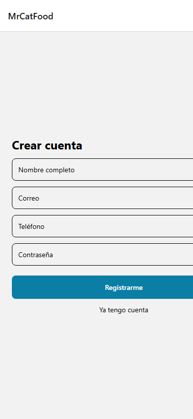
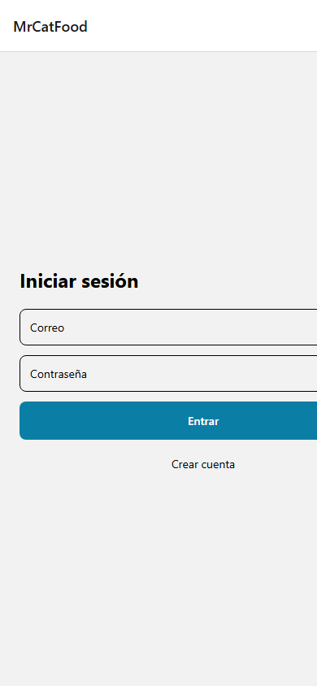

# Manual de cliente — MrCatFood

Este manual explica el flujo completo para registrarse, configurar la ubicación y realizar un
pedido. Los nombres y datos mostrados son de demostración.

## 1. Crear una cuenta

1. Abre MrCatFood.
2. En **Iniciar sesión**, selecciona **Crear cuenta**.
3. Escribe nombre, correo, teléfono y una contraseña de al menos ocho caracteres.
4. Selecciona **Registrarme**.

El teléfono debe contener entre 7 y 15 dígitos. Si un campo no es válido, la aplicación muestra
debajo qué debes corregir. Después del registro la sesión queda iniciada automáticamente.

## 2. Iniciar y cerrar sesión

Si ya tienes cuenta:

1. Escribe el correo y la contraseña.
2. Selecciona **Entrar**.
3. Para terminar la sesión, usa **Salir** en la parte superior de la pantalla.

Un mensaje de credenciales inválidas no revela si el correo o la contraseña fueron el problema.

## 3. Guardar la ubicación

Antes de confirmar el primer pedido:

1. Abre la pestaña **Perfil**.
2. Entra a **Mi ubicación**.
3. Escribe el conjunto residencial y el apartamento, incluyendo torre o interior cuando aplique.
4. Selecciona **Guardar ubicación**.

Puedes volver a esta pantalla para corregir los datos. El cambio se usa en pedidos nuevos; los
pedidos anteriores conservan la ubicación que tenían al confirmarse.

## 4. Consultar el catálogo

1. Abre la pestaña **Catálogo**.
2. Revisa nombre, ingredientes, precio, stock y estado **Disponible** o **Agotado**.
3. Selecciona una tarjeta para abrir el detalle.
4. Usa **Agregar al carrito**. Un producto agotado no puede agregarse.

El botón **Actualizar** permite volver a consultar si aparece un estado vacío o un error de red.

## 5. Preparar el carrito

1. Abre **Carrito**.
2. Aumenta o disminuye la cantidad de cada producto.
3. Revisa el subtotal calculado.
4. Elimina cualquier producto que ya no quieras.
5. Selecciona **Continuar**.

El total definitivo siempre se recalcula en el servidor al confirmar. Si otro cliente agotó un
producto, recibirás un mensaje y podrás corregir el carrito.

## 6. Elegir entrega y revisar

1. Selecciona una fecha futura.
2. Escribe una hora dentro de la ventana mostrada por la aplicación.
3. Añade notas opcionales, por ejemplo “sin salsas”.
4. Continúa a **Confirmación**.
5. Revisa productos, cantidades, ubicación, fecha, hora, notas y total.

La revisión no crea todavía el pedido. Puedes regresar y corregir los datos. La recepción de
pedidos también tiene un horario; fuera de él la aplicación muestra el intervalo válido.

## 7. Confirmar el pedido

Selecciona **Confirmar pedido** una sola vez y espera la respuesta. Al completarse:

- se muestra el código del pedido;
- el inventario queda reservado;
- el carrito se vacía;
- puedes abrir el detalle desde **Mis pedidos**.

No cierres la aplicación mientras el botón muestre el indicador de carga.

## 8. Consultar pedidos

1. Abre **Mis pedidos**.
2. Selecciona un pedido para ver código, estado, entrega, ubicación, productos y total.
3. Los estados avanzan por `PENDIENTE`, `CONFIRMADO`, `EN_PREPARACION` y `ENTREGADO`. Un pedido
   también puede quedar `CANCELADO`.

La lista solo contiene pedidos de tu cuenta.

## 9. Enviar por WhatsApp

Desde el detalle de un pedido:

1. Selecciona **Enviar por WhatsApp**.
2. La aplicación abre el chat de la propietaria con el mensaje preparado.
3. Revisa el texto y confirma el envío en WhatsApp.

Si el dispositivo no puede abrir WhatsApp, la aplicación permite copiar o abrir el enlace con una
alternativa disponible. MrCatFood prepara el mensaje, pero no lo envía sin tu confirmación.

## Problemas frecuentes

| Situación | Qué hacer |
|---|---|
| No aparece el catálogo | Comprueba la conexión y selecciona **Reintentar** |
| Producto agotado | Elige otro producto o espera reposición |
| Ubicación requerida | Guarda conjunto y apartamento desde **Perfil** |
| Fecha u hora rechazada | Usa una fecha futura y la ventana indicada |
| Sesión vencida | Vuelve a iniciar sesión |
| WhatsApp no abre | Usa la alternativa de enlace o copia disponible |
